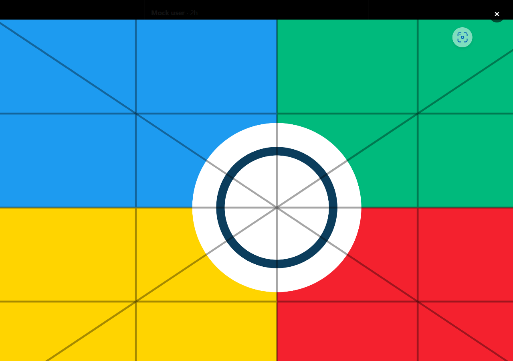

# X Pic Zoom

给 X（Twitter）网页版图片查看器加上鼠标滚轮缩放的 Microsoft Edge 扩展。

打开推文里的图片后，把鼠标放在图片上滚动滚轮即可放大 / 缩小；放大后可按住左键拖动查看细节。



## 功能

- **滚轮缩放**：在 X 的全屏图片查看器里，滚轮向上放大、向下缩小。
- **以光标为锚点**：鼠标指向的位置在缩放时保持不动，符合图片查看器的直觉。
- **拖动平移**：放大后按住鼠标左键拖动图片；拖动结束不会误触图片链接。
- **自动复位**：缩回 100%、关闭查看器、切换轮播图片、改变窗口大小时，缩放自动清除。
- **同时兼容 X 的两种查看器实现**：
  - 旧版（classic）查看器：画面由 `background-image` 图层绘制，`` 是透明的。
  - 新版（x-web）查看器：画面是真正的 ``。
  - 扩展会找到真正绘制像素的那一层来缩放，而不是盲目改 ``。
- **不干扰正常浏览**：
  - 只对推文图片查看器生效，时间线缩略图、普通页面滚动不受影响。
  - 不触碰 x-web 的个人头像查看器（它自带滚轮缩放）。
  - 发帖、裁剪等普通弹窗不会触发。
- 缩放上限 8×，100% 以下不会再缩小。
- `Ctrl/Cmd + 滚轮` 和触控板双指捏合保留给浏览器页面缩放（扩展不拦截）。

## 安装到 Edge

1. 在地址栏打开 `edge://extensions`
2. 打开左下角的 **开发人员模式**（Developer mode）
3. 点击 **加载解压缩的扩展**（Load unpacked）
4. 选择本项目的 **`extension`** 文件夹
   （也可以解压根目录的 `x-pic-zoom-v1.0.0.zip`，选择解压后包含 `manifest.json` 的文件夹）
5. 打开或刷新 `x.com` / `twitter.com`，点击任意推文图片进入查看器，把鼠标放在图片上滚动滚轮

> 如果安装扩展时 X 已经打开，请刷新一次 X 页面，让内容脚本注入。

## 使用

| 操作 | 效果 |
| --- | --- |
| 滚轮向上 | 以鼠标位置为中心放大 |
| 滚轮向下 | 缩小，到 100% 后自动复位 |
| 按住左键拖动（已放大时） | 平移图片 |
| 关闭查看器 / 切换图片 / 改变窗口大小 | 自动清除缩放 |
| 点击背景、关闭按钮、方向按钮 | 仍由 X 自己处理，扩展不干预 |
| Ctrl+滚轮 / 触控板捏合 | 浏览器页面缩放（不会缩放图片） |

## 权限与隐私

- `manifest.json` 没有声明任何 `permissions`、`host_permissions` 或后台服务。
- 内容脚本只通过 `matches` 注入 `https://x.com/*` 和 `https://twitter.com/*`。
- 不读取、不存储、不上传任何数据；没有任何网络请求。
- 不向页面 DOM 写入扩展标记；页面脚本无法通过特定属性识别本扩展。
- 只在放大期间修改目标图片/背景层的 `transform`、`transform-origin`、`cursor`、`will-change`，以及旧版查看器中被裁剪图片的祖先 `overflow`；复位时全部还原。
- 非被动滚轮监听只挂在图片查看器图层上，普通时间线滚动仍走浏览器合成器快路径。

## 项目结构

```
extension/               真正要加载的扩展
  manifest.json
  content.js             全部逻辑（无依赖）
  icons/                 16 / 48 / 128 PNG 图标
test/                    自动化测试（不随扩展加载）
  mock-x.html            模拟新版 x-web 查看器
  mock-classic.html      模拟旧版背景图层查看器
  mock-profile.html      模拟自带滚轮缩放的 x-web 个人头像查看器
  sample.svg             测试图片
  e2e.mjs                Playwright 测试脚本
tools/
  make-icons.ps1         重新生成图标
```

## 开发与测试

需要 Node.js 和已安装的 Microsoft Edge。测试直接驱动本机 Edge，不下载额外浏览器。

```bash
npm install
```

```bash
npm test
```

测试会使用系统临时目录中的一次性 Edge 配置启动浏览器，加载 `extension/`，拦截
`https://x.com/.../status/.../photo/1` 和 `https://pbs.twimg.com/media/...` 返回本地模拟页面与图片，然后验证：

- Edge 确实加载了未打包扩展，且内容脚本运行在隔离世界（页面看不到 `window.__xPicZoomInstalled`）
- 滚轮放大、光标锚定精度、8× 上限、缩回 100% 复位；80×60 的小图也能缩放
- 放大后拖动平移；拖动/普通点击不会泄漏到页面；丢失 `pointerup` 或窗口失焦会结束拖动
- 在关闭/方向按钮上结束拖动不会误关查看器
- 关闭查看器、图片源变化、`/photo/N` 索引变化、窗口缩放时自动复位
  （单纯打开/关闭查看器路由不会清掉刚缩放的画面）
- 无操作滚轮（100% 向下 / 8× 向上）不会被吞掉
- `Ctrl+滚轮` 不缩放图片，也不被 `preventDefault`
- 目标表面自身已有非单位 `transform` 时不会被覆盖
- 背景视频不会挡住前景图片的缩放；查看器内的视频/GIF 会阻止图片缩放
- 普通 `role="dialog"`（如发帖附件预览）不触发；嵌套在全屏浮层里的查看器小对话框仍能识别
- 回复抽屉里的推文卡片（`article`）不会把滚轮转给背后的照片
- 时间线图片不劫持滚轮
- 被动兜底在“查看器出现在静止光标下、还没有 pointerover”时也能完成第一次缩放
- **classic 查看器**：缩放的是背景图层，透明 `` 不动，裁剪祖先在放大时解除、复位时恢复；
  离屏轮播 slide 不会被误选
- **x-web 个人头像查看器**：扩展不抢占它的原生滚轮缩放

测试使用模拟的 X DOM 结构；已由用户在真实 Edge + x.com 上实际验证通过（2026-11-08）。

## 实现要点

- **双形态表面识别**：优先找可见且真实的 ``（x-web）；找不到时在查看器图层内找
  `pbs.twimg.com/media` 的 `background-image` 图层（classic），并选择覆盖光标的最小绘制层。
- **查看器范围**：只接受 `/status/<id>/photo/<n>` 路由，或图片位于
  `data-testid="swipe-to-dismiss"` 图层内。这样能排除发帖/裁剪弹窗和 x-web 个人头像查看器
  （后者在 `/<user>/photo` 上自带滚轮缩放）。
- **缩放数学**：`transform-origin: 0 0` + 光标锚定公式，缩放范围 1–8×；
  平移限制在“图片始终覆盖原始画面”的范围内。若选中的表面自身已有非单位 `transform`
  （X 的动画/布局），扩展不会覆盖它，避免恢复时冲掉 X 的新值。
- **裁剪处理**：classic 查看器的图片被内层 `overflow:hidden` 裁剪；放大时临时把祖先改为
  `overflow:visible`（停在 `swipe-to-dismiss` / 查看器边界之前），复位时按原值/优先级恢复。
- **滚轮监听**：非被动监听只装在查看器图层上，避免拖慢全站滚动；全局只保留一个被动兜底，
  处理“查看器刚出现、鼠标还没移动”时的第一次滚轮。
- **生命周期**：`IntersectionObserver` 处理节点离屏/关闭；轮询 300ms 的 `location.pathname`，
  只在两个 `/photo/N` 路由之间切换（索引或推文变化）时复位；单纯打开/关闭查看器不会误清缩放；
  窗口 resize 时全部复位。指针抬起丢失或窗口失焦时主动结束拖动。
- **触摸设备**：不接管触摸手势；X 自己的双指缩放/下滑关闭保持原样。桌面鼠标滚轮由扩展负责。

## 已知边界

- 仅针对推文图片查看器；视频、GIF、个人头像查看器不缩放（后者由 X 原生处理）。
- 不提供键盘缩放；`Ctrl+滚轮`/触控板捏合保留给浏览器页面缩放。
- X 若再次彻底重做查看器结构（既没有 `swipe-to-dismiss`，也不是推文 `/photo/N` 路由），
  可能需要更新识别逻辑。
